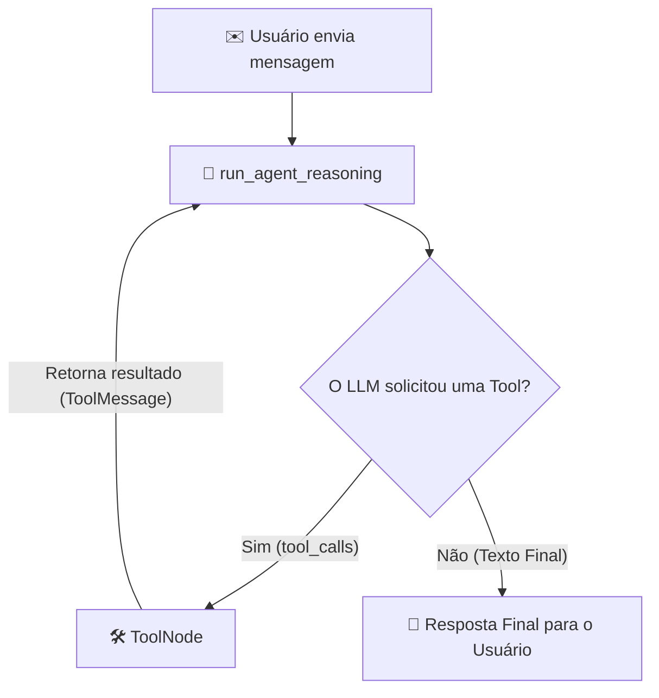

## 🤖 Arquitetura e Lógica do Agente (LangGraph)

Este projeto utiliza o **LangGraph** para criar um agente reativo fundamentado no padrão **ReAct (Reasoning + Acting)**. O fluxo intercala a tomada de decisão do modelo de linguagem (LLM) com a execução automática de ferramentas (*tools*).

---

### 🧱 Componentes Principais

1. **`run_agent_reasoning` (O Raciocínio):**
   * Funciona como a **mente** do agente.
   * Recebe a instrução do sistema (`SYSTEM_MESSAGE`) e todo o histórico de mensagens guardado no estado (`MessagesState`).
   * O LLM analisa o contexto e decide se pode responder diretamente ao usuário ou se precisa acionar alguma ferramenta externa.

2. **`ToolNode` (A Execução):**
   * Funciona como os **braços** do agente.
   * Quando o LLM decide chamar uma ferramenta (ex: `triple` ou `TavilySearch`), ele gera uma intenção (`tool_call`).
   * O `ToolNode` captura essa intenção, executa a função Python correspondente com os argumentos fornecidos e devolve o resultado ao estado como uma `ToolMessage`.

---

### 🔄 Fluxo de Execução (Ciclo do Agente)


 
```python
def run_agent_reasoning(state: MessagesState) -> MessagesState:
    """Run the agent reasoning node."""
    # 1. Injeta a instrução do sistema (persona e regras do agente)
    # 2. Passa todo o histórico de mensagens acumulado no estado
    response = llm.invoke([{"role": "system", "content": SYSTEM_MESSAGE}, *state["messages"]])
    
    # 3. Retorna a nova mensagem gerada pelo LLM para ser adicionada ao estado
    return {"messages": [response]}
```