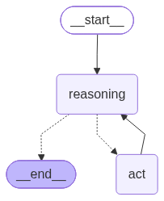
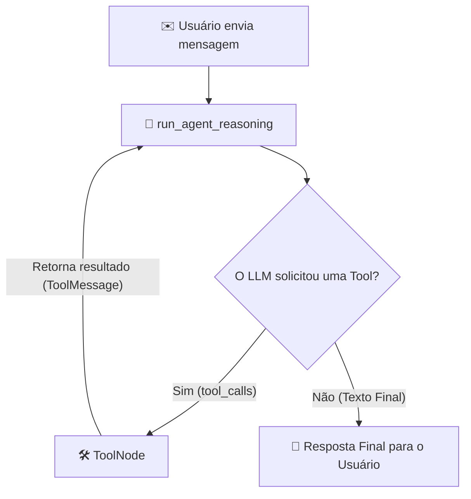

# First Fundation LangGraph

Projeto de estudo de um **agente reativo** construído com **LangGraph**, seguindo o padrão **ReAct (Reasoning + Acting)**. O agente alterna entre pensar (chamar o LLM) e agir (executar ferramentas) até conseguir responder ao usuário.

Este README serve como guia de estudo: explica a arquitetura, cada parte do código e o raciocínio necessário para construir este tipo de software do zero.

---

## Sumário

1. [Arquitetura](#arquitetura)
2. [Estrutura do projeto](#estrutura-do-projeto)
3. [Componentes](#componentes)
4. [Fluxo de execução](#fluxo-de-execução)
5. [Entendendo o grafo (main.py)](#entendendo-o-grafo-mainpy)
6. [Como executar](#como-executar)
7. [Guia: o que pensar para construir um agente assim](#guia-o-que-pensar-para-construir-um-agente-assim)
8. [Limitações e próximos passos](#limitações-e-próximos-passos)

---

## Arquitetura



O grafo possui dois nós e três transições:

| Origem      | Destino     | Tipo         | Quando                                              |
|-------------|-------------|--------------|-----------------------------------------------------|
| `__start__` | `reasoning` | Fixa         | Toda execução começa no raciocínio.                 |
| `reasoning` | `act`       | Condicional  | O LLM pediu uma ferramenta (`tool_calls` não vazio). |
| `reasoning` | `__end__`   | Condicional  | O LLM respondeu em texto puro, sem ferramentas.     |
| `act`       | `reasoning` | Fixa         | Depois de executar a ferramenta, o LLM avalia o resultado. |

O ponto central é o **loop** `reasoning -> act -> reasoning`: é ele que permite ao agente usar o resultado de uma ferramenta para decidir o próximo passo.

---

## Estrutura do projeto

```
first_fundation_langgraph/
├── react.py      # Configura o LLM e a lista de ferramentas (tools)
├── nodes.py      # Define os nós do grafo: raciocínio e execução de ferramentas
├── main.py       # Monta o grafo (estado, nós, arestas) e executa o agente
├── hello.py      # Arquivo de exemplo gerado pelo uv (não faz parte do agente)
├── flow.png      # Diagrama do grafo, gerado automaticamente por main.py
├── pyproject.toml
└── .env          # Chaves de API (não versionar)
```

Ordem de leitura sugerida para estudar: `react.py` -> `nodes.py` -> `main.py`.

---

## Componentes

### 1. `react.py` - Configuração do LLM e das ferramentas

* **LLM:** `ChatOpenRouter` com o modelo `liquid/lfm-2.5-24b-a2b` e `temperature=0` (respostas determinísticas).
* **Ferramentas (`tools`):**
  * `TavilySearch` - busca na web (retorna no máximo 1 resultado).
  * `triple` - função Python simples decorada com `@tool`, que multiplica um número por 3. Serve como exemplo de ferramenta local.
* **`.bind_tools(tools)`:** envia ao modelo o nome, a descrição (docstring) e o schema dos argumentos de cada ferramenta. Com isso, o modelo pode responder com um `tool_call` estruturado, como `{"name": "triple", "args": {"x": 21}}`. O modelo apenas **pede** a execução; ele não executa código.

#### Por que `bind_tools` e `ToolNode` usam a mesma lista `tools`?

São duas responsabilidades separadas:

| Recurso | Quem usa | O que faz | Chama o LLM? |
|---------|----------|-----------|--------------|
| `bind_tools(tools)` | Modelo | Informa quais ferramentas existem e como chamá-las | Sim (faz parte da chamada) |
| `ToolNode(tools=tools)` | Aplicação | Executa a função Python correspondente ao `tool_call` | Não |

O nome escolhido pelo modelo precisa existir na lista que o `ToolNode` executa. Por isso as duas partes recebem a mesma lista.

Resumindo: `bind_tools` é o modelo **decidindo** usar a ferramenta, e `ToolNode` é o código **usando** a ferramenta de fato.

### 2. `nodes.py` - Os nós do grafo

* **`run_agent_reasoning` (o raciocínio):** é a "mente" do agente.
  * Recebe a instrução do sistema (`SYSTEM_MESSAGE`) e todo o histórico de mensagens do estado (`MessagesState`).
  * O LLM decide se responde diretamente ou se pede uma ferramenta.
  * Retorna a nova mensagem para ser adicionada ao estado.

* **`tool_node` (a execução):** são os "braços" do agente.
  * É um `ToolNode` pronto do LangGraph.
  * Lê os `tool_calls` da última mensagem, executa a função correspondente com os argumentos gerados pelo LLM e devolve o resultado como `ToolMessage`.
  * Não chama o LLM. Sem ele, o grafo teria o pedido da ferramenta, mas ninguém a executaria.

```python
def run_agent_reasoning(state: MessagesState) -> MessagesState:
    """Run the agent reasoning node."""
    # 1. Injeta a instrução do sistema (persona e regras do agente)
    # 2. Passa todo o histórico de mensagens acumulado no estado
    response = llm.invoke([{"role": "system", "content": SYSTEM_MESSAGE}, *state["messages"]])

    # 3. Retorna a nova mensagem gerada pelo LLM para ser adicionada ao estado
    return {"messages": [response]}
```

### 3. `main.py` - Montagem do grafo

* **Estado:** `MessagesState` - uma lista de mensagens que é acumulada a cada passo.
* **Função de decisão:** `should_continue` - inspeciona a última mensagem e decide a próxima rota.
* **Nós e arestas:** `add_node`, `set_entry_point`, `add_conditional_edges`, `add_edge`.
* **Compilação:** `flow.compile()` gera o objeto `app`, que é executável.

---

## Fluxo de execução



Exemplo com a pergunta de teste do `main.py` ("Qual é a temperatura de hoje em São Paulo e multiplica por 2"):

1. `reasoning`: o LLM chama `TavilySearch` para buscar a temperatura.
2. `act`: o Tavily executa a busca e devolve o resultado como `ToolMessage`.
3. `reasoning`: o LLM lê o resultado e chama `triple` com o valor encontrado.
4. `act`: `triple` multiplica por 3 (ou o LLM decide outra operação, conforme o prompt).
5. `reasoning`: o LLM não pede mais ferramentas e responde em texto. O grafo termina em `__end__`.

---

## Entendendo o grafo (main.py)

### Por que existe o dicionário no `add_conditional_edges`?

```python
flow.add_conditional_edges(AGENT_REASONING, should_continue, {
    END: END,
    ACT: ACT,
})
```

`should_continue` devolve uma string (`"act"` ou `"__end__"`). O dicionário mapeia cada valor retornado para o nó de destino. Como as constantes `ACT` e `END` já têm exatamente esses valores, o mapeamento é redundante, mas deixa a intenção explícita. Se a função retornasse `"continue"` ou `"stop"`, o dicionário passaria a ser obrigatório para traduzir esses valores em nós.

### Por que o `add_edge(ACT, AGENT_REASONING)` é necessário?

Cria uma aresta direta, sem condição. Depois que uma ferramenta roda, o controle **sempre** volta ao raciocínio para o LLM avaliar o resultado. Sem essa aresta, o agente executaria a ferramenta e pararia, sem usar o resultado.

Em grafos lineares (A -> B -> fim), você usaria apenas `add_edge`. A aresta de volta é o que cria o ciclo típico do ReAct.

### Terminar após a ferramenta

Se quiser que o grafo encerre logo após executar uma ferramenta, troque a aresta `act -> reasoning` por `flow.add_edge(ACT, END)`.

### Geração do diagrama

`app.get_graph().draw_mermaid_png(output_file_path="flow.png")` regenera a imagem `flow.png` toda vez que o módulo é importado. O renderizador usa um serviço externo do Mermaid, então é necessária conexão com a internet.

---

## Como executar

Requisitos: Python 3.13 e [uv](https://docs.astral.sh/uv/).

1. Crie o arquivo `.env` na raiz com as chaves:

   ```env
   OPEN_ROUTER_API_KEY=sua_chave_openrouter
   TAVILY_API_KEY=sua_chave_tavily
   ```

2. Instale as dependências:

   ```bash
   uv sync
   ```

3. Rode o agente:

   ```bash
   uv run python main.py
   ```

---

## Comparação: LangGraph manual x `create_agent`

O LangChain 1.x oferece `create_agent`, que monta um loop ReAct pronto. Por baixo, ele também é um grafo do LangGraph. A versão abaixo faz o mesmo que `main.py` + `nodes.py` + `react.py`, em poucas linhas:

```python
import os
from langchain_core.messages import HumanMessage
from langchain.agents import create_agent
from langchain_openrouter import ChatOpenRouter
from pydantic import SecretStr

from nodes import SYSTEM_MESSAGE
from react import tools

# Modelo sem bind_tools: create_agent faz o bind sozinho
model = ChatOpenRouter(
    api_key=SecretStr(os.getenv("OPEN_ROUTER_API_KEY", "")),
    model="liquid/lfm-2.5-24b-a2b",
    temperature=0,
)

agent = create_agent(model=model, tools=tools, system_prompt=SYSTEM_MESSAGE)

res = agent.invoke({"messages": [HumanMessage(content="Qual e a temperatura de hoje em São Paulo me traga é multipla por 2")]})
print(res["messages"][-1].content)
```

| Aspecto | LangGraph manual (este projeto) | `create_agent` |
|---------|--------------------------------|----------------|
| Linhas de código | Mais: estado, nós, arestas, compilação | Poucas: modelo, ferramentas e prompt |
| Controle do fluxo | Total: você define cada nó e aresta | Padrão ReAct fixo |
| Estado customizado | Sim, basta alterar o `TypedDict` | Via `context_schema` e middlewares |
| Fluxos fora do ReAct | Fácil: etapas fixas, ramos, validações | Exige middlewares ou um grafo próprio |
| Ideal para | Aprender a arquitetura, casos complexos | Agentes simples e prototipagem rápida |

Este projeto usa a versão manual de propósito: o objetivo é entender o que `create_agent` esconde.

### Quando faz sentido usar LangGraph em produção

Se o fluxo fosse apenas ReAct, `create_agent` bastaria. O LangGraph manual (com `nodes.py` e `react.py`) se justifica quando há pelo menos uma destas situações:

- **Etapas fora do padrão ReAct:** validação antes de agir, ramos por regra, aprovação humana, execução de ferramentas em paralelo.
- **Estado próprio além das mensagens:** campos como contadores, documentos recuperados ou flags, com regras de transição específicas.
- **Controle explícito do loop:** definir quando o loop para, com limite de iterações e fallback próprio em vez do comportamento padrão.

Sem nenhuma dessas situações, o grafo manual adiciona código para manter sem trazer benefício real.

---

## Guia: o que pensar para construir um agente assim

Esta seção resume o raciocínio por trás do projeto. Use-a como checklist ao construir outro agente.

1. **Defina o estado primeiro.** Pergunte: "que informação precisa persistir entre os passos?" Aqui é só o histórico de mensagens (`MessagesState`). Em projetos maiores, o estado pode incluir contadores, documentos recuperados, flags de decisão etc.

2. **Separe responsabilidades em nós.** Cada nó deve fazer uma coisa: pensar (LLM) ou agir (ferramenta). Isso facilita testar e trocar partes isoladamente.

3. **Decida quem controla o fluxo.** Há duas formas:
   * O próprio LLM decide pedindo ferramentas (usado aqui).
   * Código determinístico decide por regras (ex.: "se o valor for maior que X, vá para o nó Y").

4. **Use arestas condicionais para decisões e arestas fixas para o resto.** `should_continue` é a única bifurcação; todo o resto é previsível.

5. **Garanta que o loop termine.** Sem uma condição de parada, o agente pode chamar ferramentas indefinidamente. Em produção, adicione um limite de iterações (ex.: contador no estado) e trate erros de ferramentas.

6. **Descreva bem as ferramentas.** O LLM escolhe ferramentas pelo nome, pela docstring e pelos tipos dos argumentos. Docstrings ruins geram chamadas erradas. A docstring de `triple` é o "manual" que o modelo lê.

7. **Controle o comportamento com o prompt de sistema.** `SYSTEM_MESSAGE` define persona, regras e formato da resposta. Temperatura baixa (`temperature=0`) deixa o comportamento mais previsível.

8. **Valide com entradas que exigem ferramentas.** A pergunta de teste exige pelo menos duas ferramentas em sequência, o que testa o loop completo. Use cenários assim para verificar o grafo.

9. **Visualize o grafo.** Desenhar o grafo (`flow.png`) ajuda a detectar arestas faltando ou ciclos inesperados antes de rodar.

10. **Proteja as chaves.** Chaves de API ficam no `.env`, que não deve ir para o git.

---
